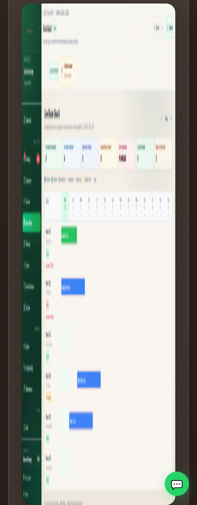
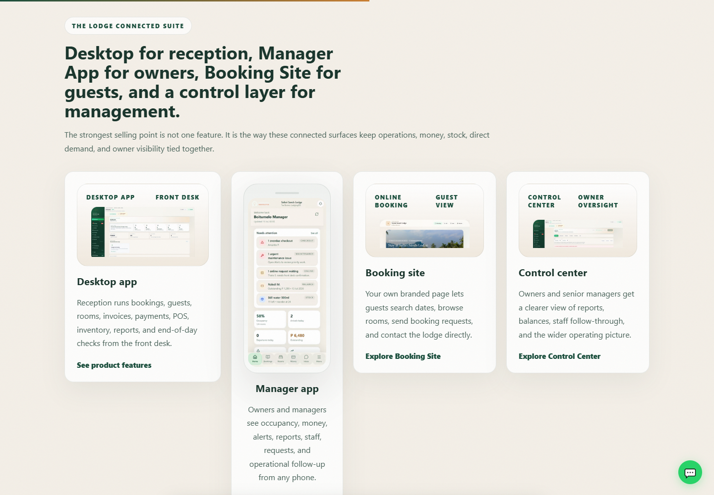
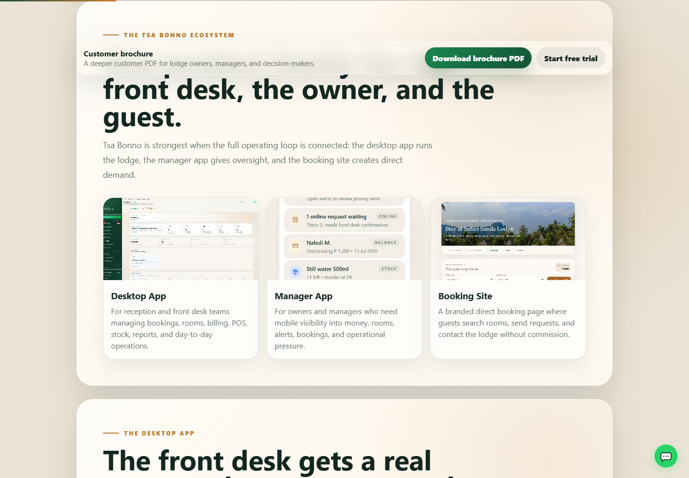
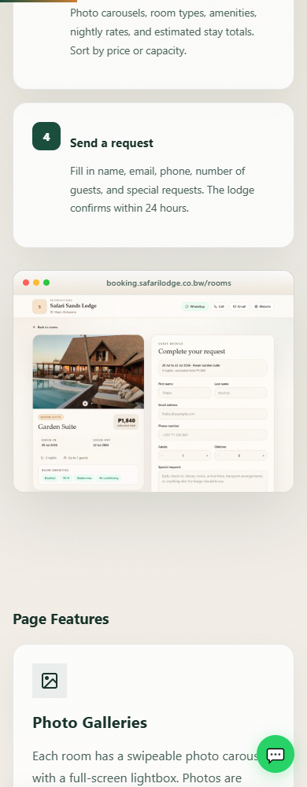
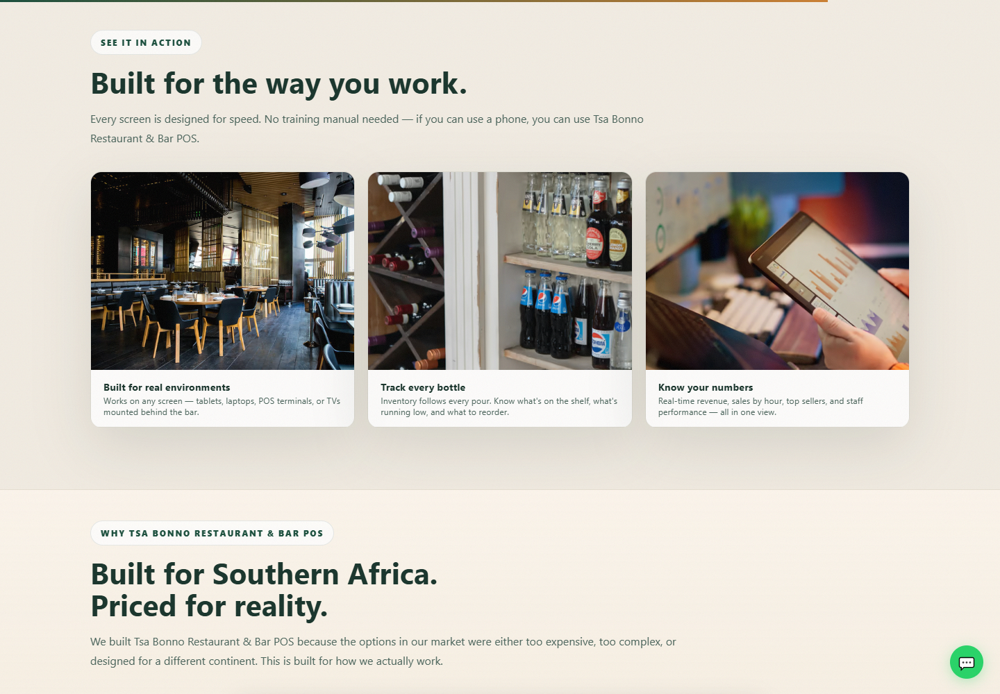

# Rendered visual review — images and cards

23 October 2026 (Africa/Gaborone). Follow-up requested by the user after the 22 October combined audit.

## What was inspected

Fresh local Microsoft Edge renders of 12 pages at 1440×1000 and 390×1000: Home, Lodge, Hotel, Restaurant POS, Bar POS, Features, Manager, Booking Site, Control Center, Packages, Hotel quotation and Brochure. Captured 90 viewport/image-detail screenshots plus eight targeted card screenshots. Images were loaded and scroll animations settled; reduced-motion mode was used to avoid judging a transient entrance animation as blur. No external submissions were sent.

I visually opened the product heroes, product cards, connected-suite cards, Manager phone cards, booking proof, Restaurant photo cards, and brochure proof cards. Measurements cover every visible image/card on the captured pages; not every screenshot was manually opened. This is a local-checkout review, not confirmation of the live domain or high-DPI device behavior.

**The reported visual problems are real. They have several different causes: severe aspect-ratio distortion, overly small full-screen previews, aggressive cropping, inconsistent card proportions, and some undersized background-image selections.** Replacing every image with a larger file would not solve all of these.

## Confirmed visual findings

| Priority | Where | What is visibly wrong | Required correction |
|---|---|---|---|
| High | Lodge and Hotel heroes | A 1920×993 screenshot renders at about 473×993 on desktop and 304×993 on phone. Text and controls become tall, narrow and smeared; the image dominates the page. | Preserve the screenshot's aspect ratio. Use height:auto or a correctly proportioned frame. On phone, 304px wide should mean about 157px tall for this image, not 993px. |
| High | Home connected-suite cards | Three small landscape previews sit beside a much taller, narrower Manager phone card. Card widths, image areas, headings and actions do not form a coherent row. Desktop screenshots are too small to explain the product. | Give each product a consistent card structure and preview area. Place portrait imagery inside that area with contain/intentional framing, or give mobile proof a separate section. Align headings and actions; do not stretch the phone to match a landscape image. |
| High | Brochure Manager proof card | A 780×1688 phone screenshot is forced into a roughly 324×172 landscape frame using cover. About three quarters of its height is cropped away. | Use a portrait preview, contain with a designed backdrop, or a deliberate labelled detail crop. Do not treat a phone screenshot like a landscape photograph. |
| Medium | Home, Restaurant, Control Center and Booking screenshot previews | Whole application screens are reduced to roughly 144–562px wide. Their tiny interface text looks soft or pixelated and is often unreadable, even where the source has enough pixels. Floating labels also cover some of the proof. | Use tightly selected workflow crops, larger previews and accessible enlargement. Show one useful interaction rather than a whole desktop of tiny text. Keep explanatory labels outside important controls. |
| Medium | Some full-width desktop photo backgrounds | Responsive markup declares a desktop slot of 1180px, while the painted image is about 1498px wide after scaling at the tested viewport. Several pages choose a 1280px raster, requiring enlargement. | Make sizes describe the actual full-width slot, account for intentional scale, and provide appropriate source dimensions. Verify selected currentSrc at desktop and high-DPI sizes. |
| Medium | Bar page and small-screen framing | The Bar header is unstyled; its links run together. The dark installer note is hard to read. The floating WhatsApp control can sit over image details on phone. | Use the common responsive header, readable dark-theme tokens and coordinated floating-control spacing. |
| Low | Home product-family cards | These text cards are sharp, not pixelated. However, titles wrap to different line counts and descriptions/lists begin at different heights. | Keep the card design, but normalize title/content spacing and add a clearly visible Hotel Coming soon state. Avoid a blanket redesign based on image issues elsewhere. |

## Evidence to view

### Severe image distortion

The Hotel phone image visibly demonstrates the problem; Lodge uses the same sizing rule.

Source: marketing-site/styles.css:2979 sets width:100% without resetting the explicit image height. Lodge and Hotel markup retain height=993. The source files themselves are landscape images.

### Unbalanced homepage suite cards

Source: the Home ecosystem mixes landscape showcase cards with an ecosystem-phone variant and different image proportions. This is a layout/composition defect, not evidence that the text-card rendering is low resolution.

### Phone screenshot cropped into a landscape brochure card

Source: marketing-site/brochure.html:395–398 gives proof-card images a common fixed height and object-fit:cover. Cover preserves proportions but discards content when source and frame shapes differ greatly.

### Small application proof on a phone

The image is not stretched. The problem is that a complete two-column desktop screen is being used as proof inside a phone-width image. A closer crop of the important booking interaction would communicate more clearly.

### Cards that are already visually sound

These photo cards preserve a coherent row and their intentional crops work as atmosphere imagery. They should not be classified with the distorted Lodge/Hotel screenshots. Their copy/product accuracy remains subject to the combined audit.

## Image-quality guidance

- Distinguish an image's raw pixel dimensions from the browser's density-adjusted naturalWidth. The review checked actual asset metadata before calling a source undersized.
- For example, the Home background selected a real 1280×854 AVIF for an approximately 1498px-wide painted image. Some other photos have sufficient raw pixels, so the same diagnosis does not apply universally.
- The current generator applies lossy AVIF/WebP settings to photos and UI screenshots alike. That can be unsuitable for fine interface text; compare equal-size screenshot exports before choosing compression. Prefer crisp screenshot exports, suitable resolution and meaningful crops. Do not try to repair text with artificial sharpening.
- Use cover for photography where cropping is intentional. For complete UI proof, use contain or an intrinsic aspect ratio. If a crop is intentional, select the workflow region explicitly.
- Treat 2× pixel density, 768px tablet layouts and zoom as follow-up acceptance checks; this capture pass used device scale 1 at two widths.
- A horizontally scrollable package comparison was detected on phone. That is intentional overflow within its container, not evidence that the whole site is broken or that the card is pixelated.

## HotelOS — Coming soon, with a persuasive feature page

The user has directed that HotelOS be temporarily unavailable. Keep the page visible and make it a strong preview of hotel operations; do not grey out or hide its benefits.

1. Display a clear **Coming soon** badge on the Hotel page, Home product card and relevant package/download surfaces.
2. Temporarily disable trial, installer download, purchase and activation paths. Replace these with **Register interest** or **Request a demo**. Explain the action's outcome.
3. Replace the green Lodge room-board proof with genuine HotelOS imagery. Show the arrivals/departures board, a guest folio, room readiness/housekeeping and night audit as four focused feature stories.
4. Explain benefits in hotel language: a clearer handover, visible guest balances, coordinated room readiness and a controlled close. Keep core, optional and future capabilities distinguishable.
5. Present a larger, correctly proportioned main screenshot, then readable workflow detail crops. Do not imply that a source implementation has already been released or commissioned.
6. Keep future quotation and pricing preparation separate from an available-now purchase promise. Carry Coming soon status into confirmations and the brochure.

This is a report direction. The current website was not edited, and the screenshots deliberately show its present trial/download controls.

## Recommended visual repair order

1. Correct Lodge/Hotel aspect ratios and Home suite-card composition.
2. Replace the cropped brochure phone proof and unreadably small full-screen previews.
3. Correct responsive background selection, then choose screenshot-specific export settings.
4. Repair Bar framing and align card content/actions across desktop and phone.
5. Apply the Hotel Coming soon presentation consistently, using real Hotel proof.

Re-render the affected sections after each change. Acceptance should include proportional images, meaningful readable proof, deliberate cropping, coherent card dimensions and no overlay hiding important content. Existing source-string tests cannot establish visual quality.

Supporting artifacts: [image/card measurements](visual-evidence.json), [raw asset dimensions](asset-metadata.json), [targeted card capture list](card-captures.json). No website assets or application code were changed. No Bar manual update is required for audit documents alone.
